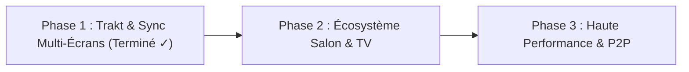

# Stremo — Présentation, Bilan & Plan de Développement Futur 🚀

Stremo est une plateforme de streaming moderne, ultra-rapide et conviviale, conçue pour réunir le meilleur de **Nuvio** et **Stremio** dans une expérience tout-en-un fluide, sécurisée et adaptée à tous les membres de la famille (du plus jeune enfant aux grands-parents).

---

## 📖 1. Présentation Générale du Projet

### 🎯 La Vision
La plupart des applications de streaming communautaires existantes souffrent de défauts majeurs :
- **Stremio** est puissant grâce à son écosystème d'add-ons, mais son interface reste austère, complexe à paramétrer pour des non-initiés, dépourvue de profils étanches avec contrôle parental sérieux, et n'intègre pas les fonctions ergonomiques modernes (saut d'intro/outro, filtrage instantané debrid, casting interactif).
- **Nuvio** propose une esthétique soignée mais peut manquer de modularité et d'une prise en charge native des protocoles multi-lecteurs et multi-formats.

**Stremo combine les deux forces :**
1. **La puissance technique de Stremio** : compatible avec 100% des add-ons Stremio (v3), proxification parallèle rapide (`Promise.allSettled`), masquage des jetons privés Debrid/AIOStreams, support des flux 4K HDR, Dolby Vision et Dolby Atmos.
2. **L'élégance et le confort de Nuvio** : design immersif sombre (palette `#07090e`), bannières cinéma en haute définition, fiches détaillées interactives, carrousels réactifs, lecteur tout équipé avec saut de générique.
3. **Une orientation familiale sans compromis** : isolation complète multi-profils (historique, reprise, favoris), mode Enfant étanche filtrant automatiquement les genres violents, et protection des profils adultes par code PIN.

---

## ✅ 2. Ce qui a été fait (Bilan des Réalisations)

### 🎨 A. Interface & Expérience Utilisateur (UI/UX)
- **Accueil Immersif (HeroBanner)** : carrousel rotatif d'arrière-plans haute fidélité avec synopsis, genres, notes IMDb authentiques et bouton « Lecture rapide » en un clic.
- **Rails de Contenu & Affiches Nuvio-style (CatalogRow)** :
  - Défilement fluide horizontal avec boutons de navigation et support complet clavier / télécommande (D-Pad).
  - Bouton de lecture centré animé au survol avec effet de flou arrière-plan.
  - Badges de notes IMDb dorés et indicateur clair du temps restant (« Reste 24m » ou « S1E3 • Reste 18m »).
  - Barre de reprise de lecture profilée sous les affiches.
- **Vue d'Exploration Multi-Catalogues (DiscoverView)** :
  - Sélecteur de type Films / Séries avec compteurs réactifs.
  - Carrousel horizontal des catalogues configurés (TMDB Popular, Netflix, Disney+, etc.).
  - Filtres de genres cinématographiques en pilules interactives.
  - Filtre local instantané en temps réel sans latence réseau.
  - Tri multi-critères : Recommandé, Note IMDb décroissante, Année décroissante, Alphabétique (A-Z).
  - Double mode d'affichage : Grille aérée (5 colonnes) et Liste détaillée.
- **Vue de Recherche Intelligente Dédiée (SearchView)** :
  - Barre de recherche principale avec auto-focus et raccourci global `/` ou `Ctrl+K`.
  - Recherche simultanée en parallèle sur films et séries avec debounce optimisé à 180 ms.
  - Historique des recherches mémorisé localement avec relance en un clic et nettoyage individuel/global.
  - Suggestions de recherche en un clic (Tendances 2026, Batman, Marvel, Science-Fiction, Action, Animation, Netflix).
  - Filtres dynamiques avec compteurs en direct (`Tous`, `Films`, `Séries`).

### 🎬 B. Fiche Média Détaillée & Gestion des Flux (MediaModal)
- **Analyse Avancée des Flux (AIOStreams / Torrentio)** :
  - Détection automatique et badges visuels : Résolution (4K, 1080p, 720p), Fournisseur Debrid (⚡ Real-Debrid, ⚡ Torbox, ⚡ AllDebrid), Codecs (HEVC, AVC), HDR / Dolby Vision, Audio (Atmos, 5.1), taille du fichier et drapeaux de langues (VF, VOST).
  - **Filtre instantané Debrid (`⚡ Debrid`)** : isolation en 1 clic des flux hébergés prêts pour la lecture immédiate sans mise en mémoire tampon.
  - Filtres par résolution (`Toutes`, `4K`, `1080p`, `720p`).
  - Classement intelligent priorisant le confort de lecture selon le lecteur choisi.
- **Navigation Épisodes & Suivi des Épisodes Vus** :
  - Sélecteur de saison et grille d'épisodes avec miniatures, résumés et numérotation.
  - **Badges d'épisodes vus (`Vu ✓`)** directement affichés sur les vignettes.
  - Bouton d'action 1-clic pour marquer ou démarquer un épisode comme vu.
- **Distribution & Filmographie Interactive** :
  - Galerie complète des acteurs et du réalisateur avec photos et noms de rôles.
  - **Recherche filmographique au clic** : cliquer sur un acteur ou un réalisateur ouvre directement sa filmographie dans l'onglet de recherche.
- **Bande-annonce Officielle** : lecteur YouTube intégré sans quitter l'application.

### ⚡ C. Lecteur Vidéo Next-Gen, Diffusion & Binge-Watching (VideoPlayer)
- **Google Cast & Apple AirPlay Intégrés** :
  - Diffusion en un clic sur TV de salon, Chromecast et récepteurs AirPlay via les API standard W3C Remote Playback et Apple WebKit.
- **Téléchargement Hors-Ligne Direct** :
  - Bouton de téléchargement 1-clic sur chaque flux direct HTTP / Debrid pour emporter ses films et séries hors connexion.
- **Saut du Générique de Fin (Outro / Credits Skip)** :
  - Détection automatique dès l'entrée dans le générique de fin (seuil configurable : 90s, 75s, 45s, 20s avant la fin).
  - Bandeau élégant « Générique de fin détecté • Épisode suivant » avec compte à rebours 10s et bouton de saut immédiat (`Touche N`).
  - Bouton pour rester sur le générique si l'utilisateur souhaite regarder une scène post-crédits.
- **Saut du Générique de Début (Passer l'intro)** :
  - Bouton d'action rapide flottant dans les 4 premières minutes de l'épisode pour avancer de 85 secondes (`Touche S`).
- **Menu Réglages « Génériques »** : réglage en temps réel du seuil d'outro et de l'enchaînement automatique sauvegardé dans le profil.
- **Gestion des Sous-titres & Décalage (Sync)** :
  - Sélection des pistes OpenSubtitles v3.
  - Décalage à la volée (`+/-0.5s`, `+/-1.0s`, reset `0s`).
  - Tailles de police au choix (`Normal`, `Grand`, `Maxi`) avec surbrillance noire contrastée.
- **Contrôles et Fonctionnalités Avancées** :
  - Vitesse de lecture (0.75x à 2.0x).
  - Mode Picture-in-Picture (PiP) natif.
  - Raccourcis clavier universels (Espace/K, F, M, N, S, Flèches).
  - Lancement direct dans les lecteurs externes desktop : **VLC**, **MPV**, lecteur système (`xdg-open`).
  - Support des Intents Android : **Just Player**, **Nova Video Player**, **MX Player**.

### 🛡️ D. Multi-Profils & Sécurité Parentale
- Mode « Gérer les profils » inspiré de Netflix avec édition du nom, de l'avatar et du PIN.
- **Mode Enfants hermétique** : filtrage algorithmique strict bannissant tout contenu violent, horrifique ou adulte et préservant les animations et contenus familiaux.
- **Contrôle Parental par Code PIN** : verrouillage instantané interdisant le passage d'un profil enfant à un profil adulte sans le PIN correct.
- **Isolation totale** en base SQLite des historiques, temps de visionnage et favoris entre chaque membre du foyer.

### 🌐 E. Trakt.tv & Synchronisation Multi-Écrans
- **Scrobbler Trakt.tv Bidirectionnel** :
  - Association de jeton d'accès personnel Trakt par profil.
  - Scrobble automatique en direct lors de la lecture (`start`), de la pause (`pause`) et de la fin de vidéo (`stop` avec historique marqué « Vu » dès 80%).
  - Proxy backend sécurisé `/api/trakt/scrobble` avec en-têtes officiels Trakt v2.
- **Sauvegarde & Migration Multi-Écrans (Export / Import 1-Clic)** :
  - Exportation complète en un clic (profils, add-ons, favoris, historique de lecture).
  - Téléchargement au format JSON et copie directe dans le presse-papier.
  - Restauration multi-écrans avec modes **Fusion intelligente** et **Écrasement complet**.

### 📦 F. Infrastructure, PWA & Add-ons
- **Progressive Web App (PWA)** : Web App Manifest, Service Worker et installation en 1 clic sur Android, iOS, Windows et Mac.
- **Navigation Télécommande / Clavier (D-Pad)** : focus rings indigo haute visibilité pour usage sur Smart TV et box de salon.
- **Gestionnaire d'Add-ons Sécurisé** : masquage des jetons secrets d'API dans les URLs d'add-ons (`token masking`).
- **Suite de tests automatisés** : 13 tests unitaires et d'intégration validant le comportement de bout en bout (`npm test`, 100% au vert).

---

## 🔮 3. Plan de Développement Futur (Roadmap)

Le développement futur de Stremo s'articule en 3 phases progressives et pragmatiques :



### 📍 Phase 1 : Synchronisation Externe & Continuité Multi-Écrans (Terminé ✓)
1. **Intégration Trakt.tv Bidirectionnelle** :
   - ✅ Scrobble en temps réel (start/pause/stop) et marquage automatique des épisodes et films vus.
   - ✅ Gestion sécurisée des jetons par profil utilisateur.
2. **Synchronisation Multi-Appareils (Sauvegarde 1-Clic)** :
   - ✅ Export JSON et presse-papier pour transfert instantané PC / Mobile / Android TV.
   - ✅ Restauration en mode fusion intelligente ou écrasement.
3. **Diffusion Google Cast & Apple AirPlay** :
   - ✅ Bouton de diffusion intégré dans le lecteur vidéo.
4. **Téléchargements Locaux Hors-Ligne** :
   - ✅ Téléchargement direct 1-clic pour les flux Debrid et HTTP.
5. **Proxy de Streaming Anti-CORS & Convertisseur WebVTT** :
   - ✅ Proxy HTTP 206 Range (`/api/proxy/stream`) contournant les restrictions CORS des CDN distants (Torbox, Real-Debrid).
   - ✅ Conversion automatique et normalisation WebVTT (`/api/proxy/subtitle`) pour 100% des sous-titres OpenSubtitles.
6. **Base Communautaire de Chapitrage (AniSkip / TheTVDB Chaptering)** :
   - ✅ Détection des génériques basée sur les timecodes exacts vérifiés par la communauté pour un saut d'intro/outro au millième de seconde près.

### 📍 Phase 2 : Écosystème Salon, Android TV, Sync Foyer, LAN & Télécommande SSE (Terminé ✓)
1. **Appairage Express TV / PC / Mobile & Synchro Continue** :
   - ✅ Code PIN 6 caractères & QR Code pour appairer n'importe quel écran TV en 5 secondes sans saisir de mot de passe.
   - ✅ Appairage instantané sub-50ms via Server-Sent Events (SSE).
   - ✅ Découverte automatique des appareils sur le réseau local Wi-Fi (Zero-Conf LAN Discovery) avec association en 1 clic.
   - ✅ Télécommande mobile tactile temps réel (Play/Pause, saut +/-10s, volume, saut intro, épisode suivant).
   - ✅ Canal de synchronisation continue du foyer (Family Sync Hub) avec auto-push et auto-pull en tâche de fond.
2. **Interface Salon 10-Pieds (10-Foot UI)** :
   - ✅ Détection automatique des appareils Smart TV (Android TV, Tizen, WebOS, Fire TV, Chromecast).
   - ✅ Raccourci clavier / télécommande `T` et bouton dédié pour activer le mode TV.
   - ✅ Affiches et typographie agrandies haute lisibilité, focus rings amplifiés, bandeau d'assistance télécommande.
3. **Préférences Linguistiques Intelligentes & Rail « Ma Liste »** :
   - ✅ Détection automatique de la langue audio du flux (VF, MULTI, VO) et activation intelligente des sous-titres (VOSTFR).
   - ✅ Rail « Ma Liste » intégré sur l'écran d'accueil avec synchronisation multi-écrans.
4. **Auto-Fallback & Sélecteur de Flux en Direct** :
   - ✅ Basculement automatique transparent vers le flux suivant en cas d'erreur de lecture (compte à rebours 3s).
   - ✅ Sélecteur de flux en direct dans le lecteur vidéo sans interruption (`Flux (N)`).
5. **Mode Nuit & Boost Dialogues Audio** :
   - ✅ Compresseur dynamique audio Web Audio API pour adoucir les déflagrations et magnifier les dialogues de nuit.
6. **Saut Automatique d'Intro & Vérification Debrid** :
   - ✅ Saut automatique d'intro configurable par profil (+85s par défaut).
   - ✅ Endpoint de suivi du statut et des jours d'abonnement Real-Debrid et Torbox.
7. **« Lecture Rapide 1-Clic » (Smart Instant Autoplay)** :
   - ✅ Résolution automatique en arrière-plan et sélection instantanée du meilleur flux adapté aux préférences de langue du profil (VF/VOSTFR) et compatibilité web sans étape intermédiaire.
8. **Gestionnaire de Téléchargements Hors-Ligne Dédié** :
   - ✅ Interface complète des vidéos téléchargées, forçage d'en-tête HTTP `Content-Disposition`, re-téléchargement et lecture directe hors-ligne (`Alt+D`).
9. **Tableau de Bord & Statistiques de Visionnage (« Mes Statistiques »)** :
   - ✅ Suivi du temps de visionnage total, compteur de médias terminés, série la plus dévorée (Top Binge), répartition des genres favoris et badges cinéphiles.
10. **Contrôles Vidéo Étendus & Sleep Timer** :
   - ✅ Sélecteur de vitesse de lecture de 0.5x à 2.0x avec raccourcis clavier `[` et `]`, bascule directe Mode Nuit `D`.
   - ✅ Minuteur de mise en veille (Sleep Timer) configurable (15m, 30m, 45m, 60m, Fin d'épisode / touche `T`) avec fondu sonore sur les 5 dernières secondes.
   - ✅ OSD HUD éphémère centré sur les raccourcis de volume, vitesse, seek et mode nuit.
11. **Glisser-Déposer & Import de Sous-Titres Locaux (.srt / .vtt)** :
   - ✅ Détection de drag-and-drop sur la vidéo et bouton d'importation dans le menu sous-titres avec conversion WebVTT instantanée.
12. **Rail Dynamique « ⚡ À Suivre / Prochains Épisodes » (Next Up Queue)** :
   - ✅ File de lecture intelligente prédisant automatiquement l'épisode suivant (`S{s}E{e+1}`) dès qu'un épisode est vu à plus de 85%, avec badge émeraude et lancement 1-clic.
13. **Cache Intelligent Multi-Niveaux SQLite (`cache_store`)** :
   - ✅ Persistance en base SQLite des métadonnées (TTL 24h), catalogues (TTL 15m), flux de streaming (TTL 4m) et sous-titres (TTL 1h) pour une réactivité instantanée et une résilience réseau totale.
14. **Store d'Add-ons Communautaires Intégré (`AddonManager`)** :
   - ✅ Catalogue de 13 add-ons vérifiés, navigation par catégories (`Flux & Debrid`, `Catalogues SVOD`, `Sous-titres`, `Animés`, `Médias & Live`), filtrage en temps réel et installation 1-clic.
15. **Support Avancé Magnet & P2P Torrent (Free Streaming sans Debrid)** :
   - ✅ Détection des flux `magnet:`, comptage des seeders (`👤 87 seeders`), badge `🧲 P2P Torrent`, bouton « Copier le lien magnet » et routage externe vers VLC / MPV.
16. **Packaging Desktop Natif & Mode Fenêtre Dédié** :
   - ✅ Script `npm run desktop` avec accélération GPU Vaapi, raccourci système `stremo.desktop`, et structure Electron (`electron/main.cjs`).
17. **Égaliseur d'Image Vidéo & Ratios d'Aspect Dynamiques** :
   - ✅ 5 ratios d'aspect commutables (`contain`, `cover`, `16/9`, `21/9`, `4/3`), raccourci clavier `A` et affichage OSD HUD centré.
   - ✅ Égaliseur d'image GPU : réglage temps réel de la Luminosité, Contraste et Saturation (0% à 200%).
   - ✅ 4 profils cinéma instantanés : Standard, Cinéma Sombre, Éclatant (Vivid), Noir & Blanc Rétro.
18. **Signets Personnels & Marqueurs Interactifs de Timeline** :
   - ✅ Mémorisation instantanée par touche `B` ou via l'interface avec titre personnalisé.
   - ✅ Marqueurs ambrés interactifs positionnés fidèlement sur la barre de progression avec saut instantané.
   - ✅ Tiroir de consultation et suppression des signets avec persistance SQLite étanche par profil.
19. **Fiche Artiste & Filmographie Complète (`PersonModal`)** :
   - ✅ Navigation fluide par acteur ou réalisateur depuis la fiche média.
   - ✅ Exploration et regroupement automatique des œuvres associées dans les catalogues.
   - ✅ Lancement et ouverture directe des films et séries de la filmographie sans quitter le contexte.

### 📍 Phase 3 : Streaming Torrent WebTorrent In-Browser (Terminé ✓) & Transcodage Optionnel
1. **Streaming Torrent WebTorrent Embarqué (Séquentiel en Direct)** :
   - ✅ Moteur WebTorrent optimisé côté serveur Express (`server/src/torrentEngine.ts`) avec initialisation paresseuse et téléchargement séquentiel des pièces vidéo.
   - ✅ Support complet HTTP 206 `Partial Content` et `Range Requests` permettant le saut direct (seek) dans la timeline sans attendre le fichier complet.
   - ✅ Sélection automatique du fichier vidéo principal (`.mp4`, `.mkv`, `.webm`) et désélection des fichiers superflus pour économiser la bande passante.
   - ✅ Télémétrie P2P en temps réel dans le header du lecteur vidéo : affichage du débit (Mo/s), du nombre de pairs connectés et du pourcentage téléchargé.
   - ✅ Bouton 1-clic « ⚡ Lire P2P » directement dans le lecteur web avec conservation du lancement externe VLC (`vlc`).
2. **Transcodage Serveur à la Volée (Optionnel pour NAS)** :
   - Transcodage matériel (NVENC / Intel QuickSync) pour lire des vidéos 4K HEVC ou profils audio non reconnus par les vieux navigateurs.

---

## 🎤 4. Plan de Présentation & Guide de Démonstration

Ce plan est conçu pour présenter le projet à des proches, des utilisateurs finaux ou des contributeurs techniques.

### ⏱️ Pitch en 30 Secondes (L'Elevator Pitch)
> « Stremo est une plateforme de streaming open source moderne qui réunit toute votre médiathèque en un seul endroit. Compatible avec tous les add-ons Stremio, elle offre une interface soignée inspirée de Nuvio, une lecture 4K instantanée sans attente via Debrid, le saut intelligent des génériques d'intro et de fin, et un vrai contrôle parental multi-profils avec code PIN. C'est l'application familiale par excellence : aussi simple pour un enfant de 6 ans que pour ses grands-parents. »

### 🎬 Déroulé de Démonstration Pas à Pas (10 Minutes)

| Étape | Action démontrée | Effet recherché |
| :--- | :--- | :--- |
| **1. Accueil & Profils (1 min)** | Démarrer l'application, montrer le sélecteur de profils avec avatars colorés. Sélectionner le profil « Principal ». | Montrer l'immédiateté et la clarté visuelle type Netflix. |
| **2. Le Billboard & Accueil (2 min)** | Faire défiler le carrousel cinéma en haut, puis les rails horizontaux. Pointer le bouton de lecture centré au survol et le temps restant (« Reste 24m »). | Souligner la fluidité et le design épuré sans publicité ni surcharge. |
| **3. Recherche Instantanée (1 min)** | Taper `/`, entrer « Batman ». Montrer la recherche simultanée films/séries en 180 ms et les filtres de catégories. | Prouver la rapidité foudroyante face aux lenteurs de Stremio officiel. |
| **4. Fiche Média & Filtres Debrid (2 min)** | Ouvrir un film. Montrer l'analyse des flux, le filtre `⚡ Debrid`, et cliquer sur un acteur pour ouvrir sa filmographie. | Démontrer la valeur ajoutée pour les cinéphiles et utilisateurs de Real-Debrid. |
| **5. Le Lecteur & Saut de Générique (2 min)** | Lancer une série. Cliquer sur « Passer l'intro (+85s) ». Avancer vers la fin pour voir le bandeau d'épisode suivant apparaître dès le début du générique de fin. | **Moment fort ("Whaou")** : confort de binge-watching identique aux plateformes payantes. |
| **6. Sécurité & Mode Enfant (2 min)** | Basculer sur le profil « Enfants » : constater la disparition de tout contenu violent. Tenter de revenir sur « Principal » : le code PIN bloque l'accès. | Rassurer les parents sur la protection familiale totale. |

---

## 💻 5. Commandes Utiles pour le Déploiement

### Installation des Dépendances
```bash
npm install
npm run install:all
```

### Lancement en Mode Développement
```bash
# Terminal 1 : Backend Express
npm run dev --prefix server

# Terminal 2 : Frontend Vite
npm run dev --prefix client
```

### Lancement de la Suite de Tests
```bash
npm test
```

### Compilation & Déploiement Production
```bash
npm run build
npm run start --prefix server
```

---

*Stremo est développé avec passion pour offrir l'expérience de streaming la plus libre, rapide et élégante du web.*
